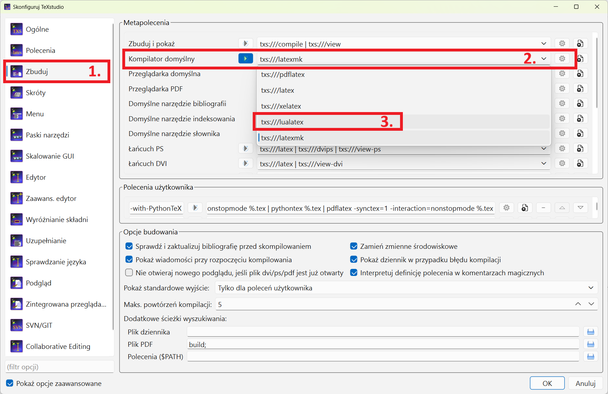
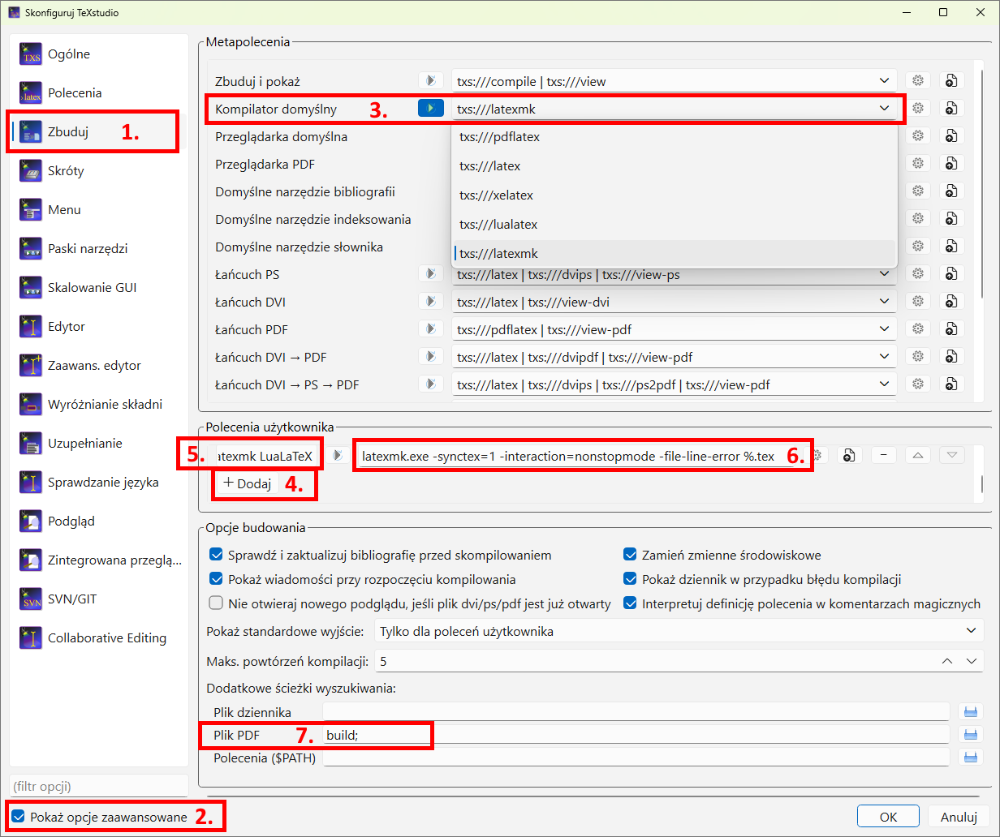

# Szablon projektu lub sprawozdania (LaTeX)

Szablon służy do przygotowania dokumentacji projektu albo sprawozdania w ramach
zajęć. Obsługuje opracowania indywidualne i zespołowe.

## Spis treści

- [Powiązany szablon pracy dyplomowej](#powiązany-szablon-pracy-dyplomowej)
- [Szybki start](#szybki-start)
- [Projekt czy sprawozdanie](#projekt-czy-sprawozdanie)
- [Autorzy projektu](#autorzy-projektu)
- [Tryb roboczy i końcowy](#tryb-roboczy-i-końcowy)
- [Struktura raportu](#struktura-raportu)
- [Literatura i cytowania](#literatura-i-cytowania)
- [Rysunki, jednostki i kod](#rysunki-jednostki-i-kod)
- [Polskie znaki w listingach](#polskie-znaki-w-listingach)
- [Kompilacja](#kompilacja)
  - [Wymagania lokalne w systemie Windows](#wymagania-lokalne-w-systemie-windows)
  - [Budowanie dokumentu](#budowanie-dokumentu)
  - [Przekroczenie czasu kompilacji w Overleaf](#przekroczenie-czasu-kompilacji-w-overleaf)
  - [TeXstudio](#texstudio)
- [Gotowe paczki ZIP](#gotowe-paczki-zip)

## Powiązany szablon pracy dyplomowej

Szablon dokumentacji projektu wykorzystuje konwencje opracowane dla
[szablonu pracy dyplomowej](https://github.com/EduKowol/SZABLON-Pracy-Dyplomowej),
ale ma uproszczoną strukturę dostosowaną do projektów realizowanych w ramach
zajęć. Przy przygotowywaniu pracy inżynierskiej, magisterskiej lub doktorskiej
należy skorzystać z repozytorium
[EduKowol/SZABLON-Pracy-Dyplomowej](https://github.com/EduKowol/SZABLON-Pracy-Dyplomowej).

## Szybki start

Do podstawowej kompilacji lokalnej w systemie Windows wystarczą **MiKTeX,
TeXstudio i LuaLaTeX**. Perl nie jest wymagany. Jest potrzebny dopiero wtedy,
gdy użytkownik chce korzystać z opcjonalnej automatyzacji przez `latexmk`.

1. Uzupełnij `config/metadata.tex`, zwłaszcza rodzaj i tytuł opracowania, przedmiot, prowadzącego i autorów.
2. Zastąp teksty instruktażowe w `chapters/` własną treścią.
3. Dodaj źródła do `literatura.bib` i cytuj je przez `\cite{klucz}`.
4. W TeXstudio wybierz kompilator `txs:///lualatex` i skompiluj `main.tex`.

Przy podstawowej kompilacji gotowy dokument powstanie jako `main.pdf` w katalogu
projektu. Wariant `latexmk` zapisuje wynik jako `build/main.pdf`.

## Projekt czy sprawozdanie

Ten sam szablon można wykorzystać do projektu semestralnego i sprawozdania.
W pliku `config/metadata.tex` zmień tylko wartość polecenia `\projecttype`, np.:

```tex
\newcommand{\projecttype}{Projekt semestralny}
```

albo:

```tex
\newcommand{\projecttype}{Sprawozdanie z ćwiczenia laboratoryjnego}
```

Wartość pojawi się automatycznie na stronie tytułowej oraz we właściwościach
pliku PDF. Rozdziały, które nie pasują do danego opracowania, można zakomentować
w pliku `main.tex`. Ich układ należy dostosować do wymagań prowadzącego.

## Autorzy projektu

Autorów wpisuje się w `\projectauthors`. Każdy wiersz zawiera imię i nazwisko oraz numer albumu:

```tex
\newcommand{\projectauthors}{%
  Anna Nowak & 123456 \\
  Jan Kowalski & 234567 \\
}
\newcommand{\projectpdfauthors}{Anna Nowak, Jan Kowalski}
```

## Tryb roboczy i końcowy

Podczas pracy pozostaw `\projectstatus` ustawiony na `draft`. Przed oddaniem zmień wartość na `final`; brak podstawowych metadanych spowoduje wtedy błąd kompilacji.

## Struktura raportu

- wprowadzenie;
- cel, zakres i wymagania;
- koncepcja i projekt rozwiązania;
- realizacja;
- weryfikacja i wyniki;
- organizacja i przebieg projektu;
- podsumowanie i wnioski;
- oświadczenie o wykorzystaniu narzędzi AI;
- podział zadań i procentowy udział autorów;
- literatura i opcjonalne załączniki.

Układ jest propozycją. Rozdziały można łączyć, skracać lub usuwać zgodnie z wymaganiami prowadzącego i charakterem projektu.

Informacja o wykorzystaniu AI oraz tabela wkładu autorów są domyślnie
włączone. Ich treść znajduje się w `backmatter/`, a widoczność kontrolują
ustawienia `\showaideclaration` i `\showcontributions` w
`config/metadata.tex`.

Plik `backmatter/ai-declaration.tex` jest przygotowany zgodnie z załącznikiem
nr 2A do Zasad korzystania z narzędzi AI przez studentów i doktorantów
Politechniki Opolskiej. Polityka korzystania z narzędzi sztucznej inteligencji
(AI) została opracowana na podstawie Zarządzenia nr 65/2026 Rektora
Politechniki Opolskiej. Należy pozostawić dokładnie jeden z dwóch wariantów:

- gdy AI wpłynęła na materiał — podać nazwę narzędzia, cel i zakres użycia oraz
  elementy przygotowane lub zmienione z AI, a następnie potwierdzić sprawdzenie
  wyników i odpowiedzialność za materiał;
- gdy AI nie używano w zakresie wymagającym ujawnienia — zamieścić przygotowane
  oświadczenie z wariantu 2.

Zwykła autokorekta i sprawdzanie pisowni, które nie wpływają na treść
merytoryczną, co do zasady nie wymagają ujawnienia, chyba że prowadzący określi
inaczej. Prowadzący może również zażądać bardziej szczegółowych informacji,
np. przykładowych poleceń, wyników narzędzia lub materiałów roboczych. Użycie AI
musi mieścić się w zakresie dopuszczonym przez prowadzącego oraz respektować
ochronę danych, poufność, prawa autorskie i warunki korzystania z narzędzi.

## Literatura i cytowania

Źródła należy zapisywać w pliku `literatura.bib`, a następnie przywoływać
w tekście przez ich klucze, np.:

```tex
Metodę opisano w literaturze \cite{lamport1994}.
```

Cytowania są numerowane automatycznie i wyświetlane w tekście w postaci `[1]`,
`[2]` itd. Nie należy wpisywać tych numerów ręcznie. Wykaz „Literatura” jest
porządkowany alfabetycznie według nazwiska pierwszego autora, a dla prac tego
samego autora dodatkowo według roku i tytułu. Numery pozycji wynikają z tej
kolejności alfabetycznej, a nie z kolejności pierwszego cytowania w tekście.

W pliku `literatura.bib` autorów rozdziela się angielskim słowem `and`.
Literatura jest generowana automatycznie i dodawana do spisu treści.

Przy kompilacji lokalnej pojedyncze uruchomienie LuaLaTeX nie wystarcza po
dodaniu lub zmianie źródeł. Wykonaj kolejno:

```text
lualatex main.tex
biber main
lualatex main.tex
lualatex main.tex
```

W TeXstudio odpowiada to kolejno poleceniom **LuaLaTeX**, **Biber**,
**LuaLaTeX** i ponownie **LuaLaTeX**. Jeżeli w tekście zamiast numeru pojawia
się klucz, np. `[lamport1994]`, albo nie ma wykazu „Literatura”, oznacza to, że
Biber nie został jeszcze poprawnie uruchomiony. Opcjonalny LatexMk wykonuje
cały cykl automatycznie, ale w systemie Windows wymaga Perla. Sposób jego
ustawienia przedstawiono niżej w sekcji
[Konfiguracja LatexMk w TeXstudio](#konfiguracja-latexmk).

W Overleaf wystarczy wybrać LuaLaTeX i użyć przycisku **Recompile** — serwis
korzysta z LatexMk i automatycznie uruchamia potrzebne etapy, w tym obsługę
bibliografii. Nie trzeba ręcznie wykonywać powyższych czterech poleceń. Gdy po
zmianie pliku `.bib` wynik nie zostanie odświeżony, użyj opcji **Recompile from
scratch**.

## Rysunki, jednostki i kod

Rysunki wstawiaj przez `\projectgraphic`, jednostki zapisuj pakietem `siunitx`, np. `\qty{12}{\volt}`, a kod przechowuj poza plikiem rozdziału i wczytuj przez `\lstinputlisting`.

Zalecane style kodu to `project-python`, `project-matlab`, `project-c`,
`project-cpp` i `project-shell`. Dla zgodności z przykładami ze „SZABLONU
Prezentacji” działa także zapis `[style=weail,language=Python]`.

## Polskie znaki w listingach

Styl projektu rozszerza wewnętrzną tabelę `\lst@DefEC` pakietu `listings` o
polskie litery. Dzięki temu LuaLaTeX zachowuje ich kolejność, odstępy i
kolorowanie w komentarzach, napisach oraz identyfikatorach — zarówno w
środowisku `lstlisting`, jak i w plikach wczytywanych przez
`\lstinputlisting`. Nie należy dodawać mapowania `literate`.

Znacznik kończący tabelę znaków jest generowany programowo. W pliku stylu nie
ma surowego znaku sterującego, który jest odrzucany przez nowsze wersje TeX
Live używane m.in. w Prism.

Jeżeli komunikaty błędów zaczynają się od tekstu „Ten szablon wymaga
LuaLaTeX”, wybrano niewłaściwy silnik. Komunikaty `OT1` albo `Invalid UTF-8`
w pliku `main.vrb` również są skutkiem kompilacji przez pdfLaTeX, a nie
niepoprawnego zapisu polskich znaków w kodzie. W Prism, Overleaf lub podobnym
edytorze ustaw plik główny na `main.tex`, kompilator na LuaLaTeX i po zmianie
silnika wykonaj pełną kompilację od początku (`Recompile from scratch`).
Lokalnie wybierz LuaLaTeX w TeXstudio albo uruchom `lualatex main.tex`.
Automatyzacja przez `latexmk main.tex` jest opcjonalna.

## Kompilacja

### Wymagania lokalne w systemie Windows

Na początek zainstaluj MiKTeX oraz TeXstudio. Podstawowa kompilacja korzysta
bezpośrednio z LuaLaTeX i nie wymaga Perla. Dostępność silnika można sprawdzić:

```text
lualatex --version
biber --version
```

MiKTeX dostarcza LuaLaTeX, Biber i wymagane pakiety LaTeX-a. Przy pierwszej
kompilacji może poprosić o zgodę na automatyczne doinstalowanie brakujących
pakietów.

Opcjonalny program `latexmk` automatyzuje kolejne przebiegi LuaLaTeX i Bibera,
ale w systemie Windows wymaga interpretera Perl, np.
[Strawberry Perl](https://strawberryperl.com/). Po jego instalacji należy
ponownie uruchomić terminal i TeXstudio, a następnie sprawdzić:

```text
perl --version
latexmk -v
```

Prism, Overleaf i podobne edytory internetowe nie wymagają lokalnej instalacji
Perla.

### Budowanie dokumentu

Najprostszy wariant korzysta bezpośrednio z LuaLaTeX:

```text
lualatex main.tex
```

Po zmianie cytowań lub bibliografii może być konieczne wykonanie Bibera oraz
dwóch kolejnych przebiegów LuaLaTeX:

```text
lualatex main.tex
biber main
lualatex main.tex
lualatex main.tex
```

W tym wariancie PDF powstaje jako `main.pdf` w katalogu projektu.

Opcjonalnie użytkownik, który zainstalował Perl, może zautomatyzować cały proces:

```text
latexmk main.tex
latexmk -g main.tex   # pełne przeliczenie po usunięciu błędu
latexmk -C main.tex   # usunięcie artefaktów kompilacji
```

Plik `latexmkrc` wybiera LuaLaTeX, uruchamia Biber w razie potrzeby i zapisuje
wynik jako `build/main.pdf`.

### Przekroczenie czasu kompilacji w Overleaf

W bezpłatnej wersji Overleaf kompilacja całego, rozbudowanego projektu może
zostać przerwana po przekroczeniu czasu dostępnego dla pojedynczej kompilacji.
Podczas pisania można ograniczyć kompilację do aktualnie opracowywanego
rozdziału. W preambule pliku `main.tex`, przed `\begin{document}`, odkomentuj:

```tex
\includeonly{chapters/01-wprowadzenie}
```

Wpisz nazwę rozdziału bez rozszerzenia `.tex`. Kilka rozdziałów można wskazać
po przecinku, np.:

```tex
\includeonly{chapters/01-wprowadzenie,chapters/04-realizacja}
```

Polecenie `\includeonly` jest bezpieczniejsze niż komentowanie wielu poleceń
`\include`, ponieważ lista i kolejność rozdziałów pozostają niezmienione.
Przed wygenerowaniem wersji do oddania ponownie zakomentuj `\includeonly`,
wykonaj pełną kompilację od początku (`Recompile from scratch`) i sprawdź, czy
w PDF znajdują się wszystkie rozdziały, literatura oraz oświadczenia końcowe.

Jeżeli przekroczenie czasu występuje również po ograniczeniu liczby rozdziałów,
sprawdź rozmiar dołączonych grafik i plików danych oraz czy dokument nie zawiera
zapętlonego polecenia lub bardzo kosztownych obliczeń wykonywanych podczas
kompilacji.

### TeXstudio

#### Ustawienie podstawowe — LuaLaTeX

To ustawienie jest zalecane początkującym i nie wymaga instalacji Perla:

1. Otwórz **Opcje → Konfiguruj TeXstudio** i po lewej stronie wybierz
   **Zbuduj**.
2. Zaznacz znajdującą się na dole okna opcję **Pokaż opcje zaawansowane**.
3. W polu **Kompilator domyślny** wybierz `txs:///lualatex`.
4. Zatwierdź konfigurację przyciskiem **OK**.
5. Otwórz plik `main.tex` i uruchom **Zbuduj i pokaż**.



Plik `main.tex` zawiera również dyrektywę `% !TeX program = lualatex`, która
wskazuje właściwy silnik. Przy tej konfiguracji PDF znajduje się jako
`main.pdf` w katalogu projektu. Po zmianie spisu treści, odwołań lub cytowań
może być potrzebna ponowna kompilacja; bibliografię można uruchomić poleceniem
Biber, a następnie dwukrotnie LuaLaTeX.

<a id="konfiguracja-latexmk"></a>

#### Konfiguracja LatexMk w TeXstudio — ustawienie opcjonalne

Ten wariant jest wygodny, gdy dokument ma już bibliografię i wiele odwołań.
Wymaga zainstalowanego Perla. W sekcji **Polecenia użytkownika** dodaj polecenie
o nazwie `user0:Latexmk LuaLaTeX` i treści:

```text
latexmk.exe -synctex=1 -interaction=nonstopmode -file-line-error %.tex
```

W sekcji **Opcje budowania → Dodatkowe ścieżki wyszukiwania**, w polu
**Plik PDF**, wpisz:

```text
build;
```



Na zrzucie kroki 1, 2 oraz 4--7 pokazują dodanie polecenia użytkownika i
ścieżki `build;`. W aktualnej, zalecanej konfiguracji pozostaw w kroku 3
kompilator domyślny `txs:///lualatex`, a LatexMk uruchamiaj jako polecenie
użytkownika. Wybranie `txs:///latexmk` jako kompilatora domyślnego jest
wariantem zaawansowanym i nie jest potrzebne do korzystania z szablonu.

Jeżeli LatexMk ma być uruchamiany tylko z menu poleceń użytkownika, nie zmieniaj
dyrektywy na początku `main.tex`. Jeżeli natomiast świadomie ustawiasz LatexMk
jako kompilator domyślny, zastąp pierwszą linię:

```tex
% !TeX program = lualatex
```

dyrektywą TeXstudio:

```tex
% !TeX TXS-program:compile = txs:///latexmk/{-pdf}
```

Nie pozostawiaj obu dyrektyw aktywnych jednocześnie. Fragment `{-pdf}` usuwa
z wbudowanego polecenia TeXstudio opcję wymuszającą pdfLaTeX; dzięki temu
`latexmk` odczyta projektowy plik `latexmkrc` i wybierze LuaLaTeX. Po powrocie
do podstawowej konfiguracji przywróć `% !TeX program = lualatex`.

Wartość `%.tex` oznacza aktualnie kompilowany dokument. Nie należy dopisywać do
polecenia opcji `-pdf` ani `-lualatex`: właściwy silnik i katalog wyjściowy są
ustawione centralnie w projektowym pliku `latexmkrc`. Wpis `build;` wskazuje
TeXstudio dodatkowe miejsce, w którym ma szukać utworzonego PDF-u. Średnik jest
separatorem ścieżek używanym w tym polu w systemie Windows.

Polecenie LatexMk uruchamiaj z menu poleceń użytkownika. Gotowy dokument pojawi
się jako `build/main.pdf`. Podstawowego kompilatora nie trzeba w tym celu
zmieniać z LuaLaTeX na LatexMk.

## Gotowe paczki ZIP

Katalog `dist/` zawiera dwie przenośne wersje szablonu:

- `szablon-projektu-local.zip` — do pracy na komputerze; zawiera `latexmkrc`,
  podstawowa kompilacja wymaga MiKTeX-a, a Perl jest potrzebny tylko przy
  opcjonalnym użyciu LatexMk;
- `szablon-projektu-online.zip` — do Prism, Overleaf lub podobnego edytora;
  nie zawiera lokalnej konfiguracji LatexMk, a na początku pliku `main.tex`
  ma dyrektywę `% !TeX program = lualatex` wskazującą wymagany kompilator.

Wersję online można również kompilować lokalnie za pomocą LuaLaTeX. Nie zawiera
ona pliku `latexmkrc`, dlatego nie zapewnia projektowej automatyzacji LatexMk,
a obsługa Bibera i kolejnych przebiegów LuaLaTeX może wymagać ręcznego
uruchomienia.

Oba archiwa zawierają źródła, instrukcje, rozdziały, oświadczenia końcowe,
przykładową bibliografię i generator paczek. Nie zawierają plików z `build/`,
`tmp/`, wcześniejszych archiwów ani innych artefaktów kompilacji.

Paczki tworzy program `tools/create_release.py`:

```text
python tools/create_release.py --target local
python tools/create_release.py --target online
```

Bez opcji `--target` program interaktywnie zapyta o wariant. Własną nazwę pliku
można podać przez `--output ścieżka/do/pliku.zip`.

Po każdej zmianie plików wchodzących w skład szablonu należy ponownie
wygenerować oba archiwa i zapisać je w repozytorium. Katalog `dist/` nie jest
wykluczony przez `.gitignore`.
